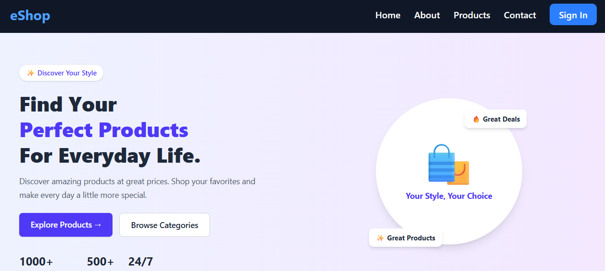
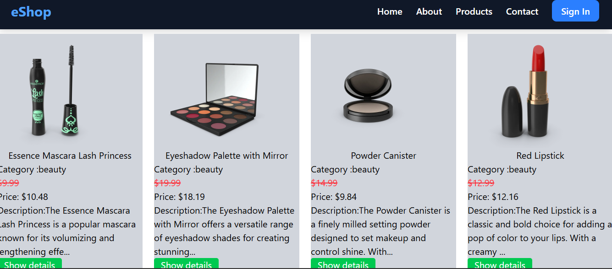

A basic e-commerce website in this context is a multi-page React application that uses React Router DOM to dynamically switch views—such as a product catalog page, detailed individual product pages, and a shopping cart page—without reloading the web browser